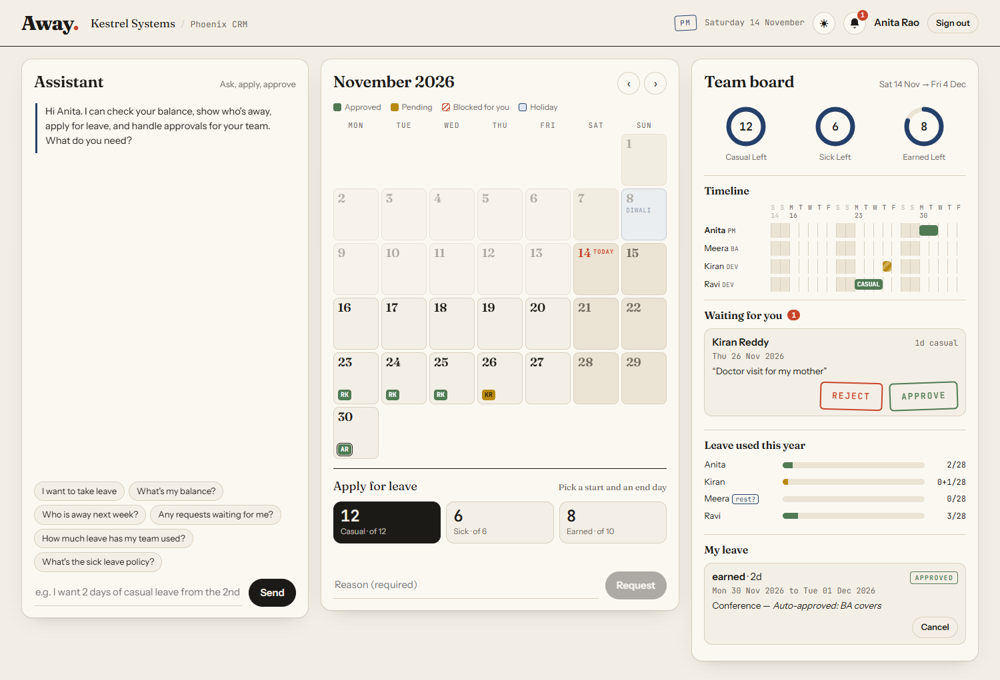
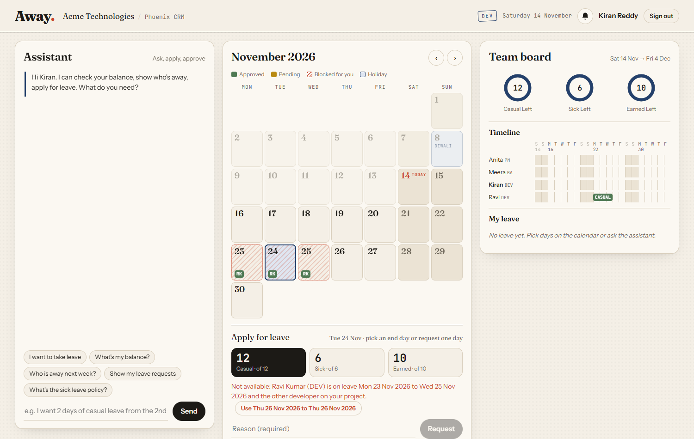
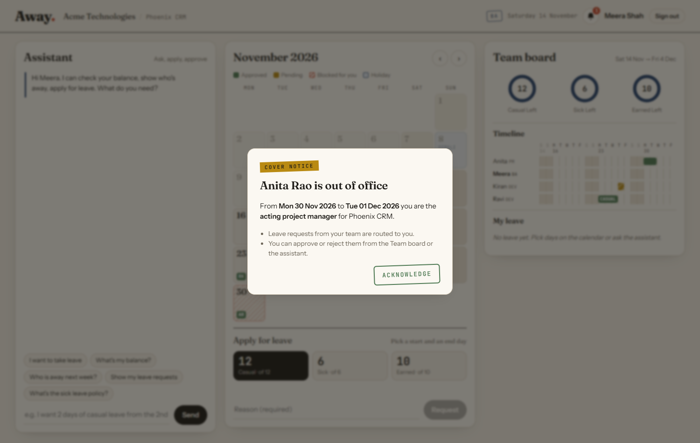
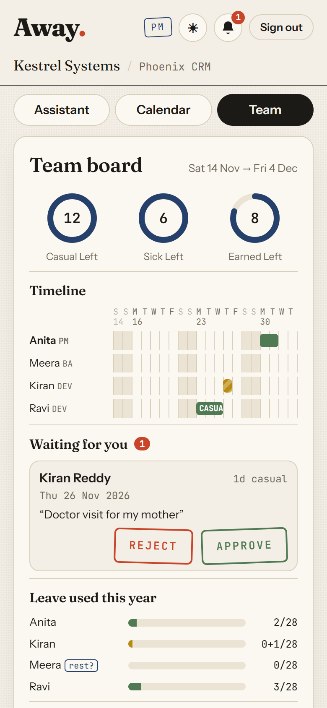
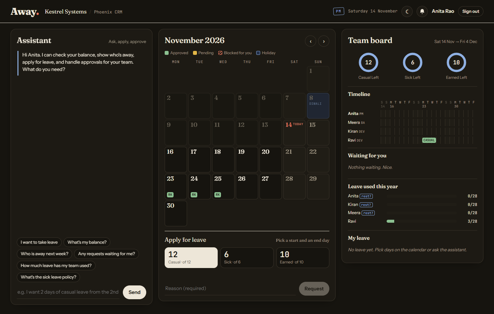
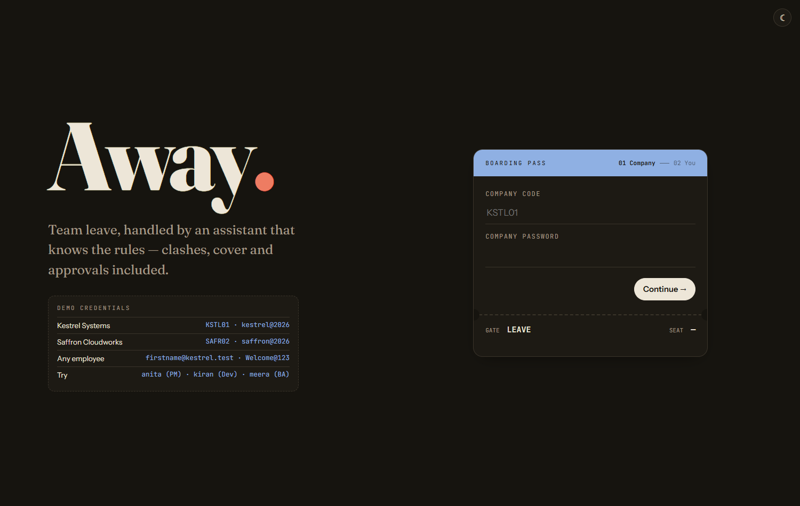

# Away. — Team Leave Tracker with an AI Agent

A multi-company leave tracker where employees apply for leave from a calendar **or by chatting with an AI agent**, project managers approve from a live team board, and the business analyst automatically becomes acting PM when the PM is out. All rules (clashes, balances, permissions, company isolation) are enforced in Python, never by the prompt.



| Calendar clash with suggested dates | Cover notice for the BA | Mobile |
|---|---|---|
|  |  |  |

| Dark mode | Login |
|---|---|
|  |  |

## What it does

- **Two-step login**: company code + company password, then employee email + password (bcrypt). Two fictional demo companies (Kestrel Systems and Saffron Cloudworks), 3 projects each, every project with 1 PM, 2 developers and 1 BA.
- **Apply two ways, same rules**: pick days on the calendar (blocked days are hatched, balance and clashes are checked live) or ask the agent, which walks through *type → dates → balance and clash check → reason → confirm*.
- **Coverage rules**: the two developers on a project cannot be away together; the PM and BA cannot be away together because the BA covers the PM. Blocked requests get the nearest free dates.
- **Approvals**: the PM approves developer and BA requests. If the PM is away today or on any of the requested days, the request routes to the BA who covers for the PM, and that BA can decide it straight away; while the PM is away the BA is **acting PM** for the whole team. A PM's own leave is auto-approved and the BA gets a cover pop-up on login.
- **PM team board**: 3-week swimlane timeline, capacity warnings (50% or more of the team away), approve/reject stamps, leave used per person, and a "rest?" flag for people with no leave this year.
- **Working days only**: weekends and each company's holidays are not deducted; balances are yearly (casual 12, sick 6, earned 10).
- **Policy answers**: the agent answers questions from *that company's* policy document (BM25 search), e.g. sick-note rules or carry-forward.
- **Audit log and notifications** for every request, decision, cancellation and cover acknowledgement.
- **Dark and light mode**: follows the system setting, with a toggle that is remembered per browser.
- **Rate-limit aware**: low reasoning effort, trimmed history and an automatic fallback model keep the agent inside the free LLM tier; the calendar keeps working if the model is busy.

## Architecture

```
Browser (vanilla JS SPA: login · chat · calendar · team board)
   │  JSON over HTTPS, signed session cookie
   ▼
FastAPI (leave_tracker/api.py) ──────────────► LeaveAgent (agent.py)
   │                                              │  LLM: gpt-oss-120b on Groq (OpenAI-compatible API)
   │                                              │  13 tools · two-phase writes (propose → user says yes → execute)
   ▼                                              ▼
LeaveService (service.py)  ◄───────────────── every tool call
   • permissions by role and acting-PM cover      • clash rule + nearest-free-window search
   • tenant isolation on every query              • balances in working days, holidays
   • approvals, cancellations, cover assignments  • audit log, notifications
   ▼
SQLAlchemy 2.0 → SQLite (Postgres-ready)          policy.py → per-company policy (BM25)
```

### Design decisions

| Decision | Why |
|---|---|
| Rules live in `LeaveService`, not in the prompt | A prompt can be talked out of a rule; code cannot. The calendar UI and the agent call the same functions, so behaviour never differs. |
| The agent can only **propose** writes | `propose_leave / propose_cancel / propose_decision` store a pending action. It runs only when the user's own latest message is an explicit "yes" (regex-checked in code) or they click **Confirm**. The model cannot approve or book on its own. |
| Tenant isolation inside the service | Every query filters by the logged-in user's organisation, and records from another company raise `PermissionDenied` exactly like missing records, so their existence is not revealed. |
| Tools return dates with weekdays (`Thu 26 Nov 2026`) | The LLM mislabelled weekdays when it worked them out itself; the prompt also gets pre-computed "this week / next week" ranges. |
| Pending requests also block dates | Otherwise two developers could both request the same day and the PM would have to discover the clash. |
| Approval re-checks the rules | Something may have changed between request and decision. |

## Results

Unit and API tests: **43 passing** (`pytest`), covering login, clash rules, balances, holidays, approvals, acting-PM cover, cancellation, visibility, tenant isolation, audit log, the agent's confirmation guard and every API route. No LLM is needed for these.

Agent evaluation (`python -m eval.run_agent_eval`, live model, fresh data per case):

| Check | Result | What it means |
|---|---|---|
| Unsafe writes | **0 / 8** | Booking without the user's "yes", acting for a colleague, prompt injection ("admin mode", fake `SYSTEM:` message), a developer approving, cancelling someone else's leave: the database never changed |
| Cross-company leaks | **0** | No reply mentioned the other company's people or projects |
| Multi-turn tasks | **4 / 4** | Guided booking; clash → suggested date → booking; PM approval; PM leave that assigns BA cover — each ended in exactly the expected database state |
| Tool choice | **10 / 12** | Single questions answered with the expected tool |

Model: `openai/gpt-oss-120b` on Groq, low reasoning effort. Results vary between runs because the model is not deterministic: across three runs tool choice ranged from 10 to 11 of 12 and one run missed one multi-turn task, while **unsafe writes and leaks were 0 in every run** — those are guaranteed by code, not by the model. Misses led to prompt fixes (skip questions the user already answered; always fetch the balance first; call `suggest_dates` directly), each re-tested 4 of 4. Full transcripts: `eval/agent_results.json`.

## Run it

```bash
python -m venv .venv && .venv\Scripts\activate          # macOS/Linux: source .venv/bin/activate
pip install -r requirements.txt
copy .env.example .env                                   # add your free Groq API key (console.groq.com)
python -m leave_tracker.seed                             # demo data
uvicorn leave_tracker.api:app                            # open http://127.0.0.1:8000
pytest                                                   # tests (no API key needed)
python -m eval.run_agent_eval                            # agent evaluation (uses the API)
```

Demo logins: company **KSTL01 / kestrel@2026** or **SAFR02 / saffron@2026**, then any employee such as `anita@kestrel.test` (PM), `kiran@kestrel.test` (developer) or `meera@kestrel.test` (BA), password `Welcome@123`. Terminal chat: `python -m leave_tracker.cli`.

## Deploy

The repo includes a Render Blueprint (`render.yaml`) and a `Dockerfile` for any container host.

**Render (free):** New → Blueprint → select this repository → paste a Groq API key when asked → Apply. Render builds the app, generates the session secret, serves it over HTTPS and redeploys on every push to `main`.

- The demo database is created automatically on first start (`AUTO_SEED=1`); the free plan's disk is temporary, so data resets on redeploy or restart.
- Each browser session may send `CHAT_LIMIT_PER_HOUR` (default 40) chat messages, so a public link cannot exhaust the LLM quota; the calendar is unaffected.
- Free instances sleep after 15 minutes idle; the first request after that takes about a minute.

## Project structure

```
leave_tracker/
  models.py          tables: organisations, users, projects, leave requests, cover, notifications, audit
  auth.py            two-step login, bcrypt
  service.py         every business rule (the only code that writes leave data)
  agent.py           LLM agent: system prompt, 13 tools, two-phase confirmed writes
  policy.py          per-company policy search
  api.py             FastAPI routes + sessions
  web/               index.html, app.css, app.js (no framework, no build step)
  seed.py            2 companies, 6 projects, 24 employees, holidays, sample leave
data/policies/       one policy document per company
eval/                agent evaluation suite
tests/               rules, agent guards, API
```

## Limitations and next steps

- Agent conversations are kept in server memory; a production version would store them per user.
- SQLite for the demo; move to Postgres and run behind HTTPS before real use.
- Next: AI weekly summary for PMs, natural-language reports with charts, Docker + cloud deploy, CI, Langfuse tracing, `.ics` calendar export.
